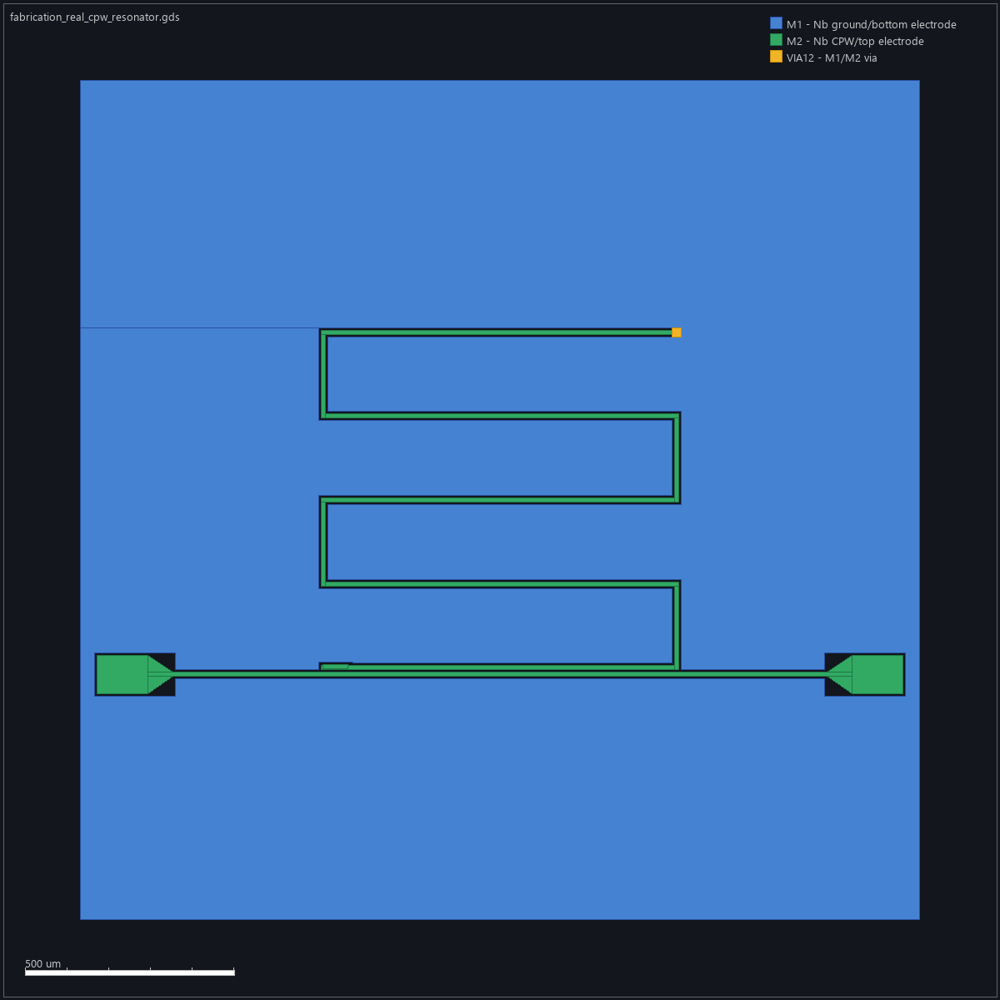

# Text-to-Layout guidebook

**Document class: MANUAL_DOCUMENTATION.** Initial guidebook and production
documentation contract. Current CLI/API examples below are grounded in source;
this documentation change has not rerun simulations or certified plugin hosts.
New desktop/web screenshots are pending implementation, not fabricated here.

Read [product requirements](../../REQUIREMENTS.md), [Design.md](../../Design.md)
and the [function/MCP catalog](../function-catalog.md) for coverage and status.
See [release status](../releases/README.md) for Python, desktop and npm delivery
and the [100-target completion checklist](../integrations/checklist.md) before
assuming a candidate solver is available.
For a paper-based accuracy workflow, follow the
[resonator result-check tutorial](scientific-result-check.md); it demonstrates
why the current bounded Palace run is invalid and what a valid comparison needs.

## Integration acceptance

- [KQCircuits geometry acceptance](../integrations/kqcircuits.md): real upstream
  export, independent GDS readback and explicit incomplete adapter/platform status.

## Python MVP numerical workflows

- [Typed scqubits transmon execution](scqubits-transmon.md): explicit SI inputs,
  retained spectra, and limits of model-only evidence.
- [Pinned public reference check](public-reference.md): installed CLI mask
  roundtrip and the missing inputs blocking electrical agreement.

## Choose an interface

| Interface | Starting point | Current boundary |
| --- | --- | --- |
| CLI | `uv run textlayout --help` | Existing product entry point; solver/platform availability varies. |
| Local API | `uv run textlayout serve --host 127.0.0.1 --port 8000` | API docs at `/docs`; this is not the finished workbench. |
| Desktop | Windows/macOS/Linux application | Planned delivery; installer walkthroughs/screenshots pending. |
| Browser | Local and hosted workbench | Planned shared UI; hosted deployment and execution not assumed available. |
| MCP | Installed `text-to-gds` stdio server | Existing legacy tool surface; discover schemas before calling tools. |
| Codex / Claude Code | Thin plugin under `plugins/text-to-gds` | Manifests exist; verify each host installation/workflow before claiming support. |

## Inspect the 100 requested integration candidates

Run the environment check from the repository root:

```sh
uv run textlayout doctor --json
```

In its JSON, `external_solvers` contains existing tool-specific checks;
`integration_targets` is the separate list of 100 user-requested candidates.
Read each candidate's `probe_status`, `probe_scope`, `source_verified`,
`license_verified` and `execution_verified` before deciding what can run.
`NOT_PROBED` calls for source/license and detector work. `FOUND` on an import
or version probe does not establish a successful simulation, numerical
convergence, platform support or access to a commercial license. Discovery
does not start a solver. If a tool is absent, use the current verified product
path or prepare inputs and report `SKIPPED_SOLVER_ABSENT`; do not silently
promote an analytical estimate to solver evidence.

**AI prompt example**

> Run `textlayout doctor --json` and list the integration candidates relevant
> to my design. Show which have source and license verification, which have an
> actual local probe, and which have retained solver results. Recommend only
> available, scientifically suitable next steps; do not run a solver during
> discovery or claim all 100 candidates are installed.

## First CLI design: explicit geometry without simulation

Run from the repository root in a terminal with Python and `uv` installed.
Python 3.12 is the project recommendation; optional solvers need separate setup.
On Windows, use PowerShell; use `py -3 -m uv` instead of `uv` if that is how uv
is installed. These commands use no shell-specific line continuation.

1. Install the locked environment:

   ```sh
   uv sync --frozen --python 3.12
   ```

2. Read available commands and inspect environment/solver readiness:

   ```sh
   uv run textlayout --help
   uv run textlayout doctor --json
   ```

   Keep the doctor output. A missing optional solver is not a passing simulation.

3. Request a bounded example without executing a solver:

   ```sh
   uv run textlayout prompt "Create a 0.6 pF IDC on silicon at 6 GHz with 2 um min gap" --out out/guidebook/idc --no-solver
   ```

   Inspect the returned file paths and report under `out/guidebook/idc`. Separate
   geometry checks and analytical target estimates from actual solver evidence.
   Do not interpret a requested 0.6 pF value as an independently measured result.

4. For deterministic DSL-driven generation, inspect the input, validate it, then
   generate an artifact packet:

   ```sh
   uv run textlayout verify examples/benchmarks/01_idc_0p6pf/layout.json
   uv run textlayout generate examples/benchmarks/01_idc_0p6pf/layout.json --out out/guidebook/idc-dsl
   ```

5. Open the returned GDS/preview and read the verification/report artifacts.
   Follow [solver installation](../simulators/install.md) before attempting a
   real simulation. Recheck solver readiness and retain logs, convergence and
   independent comparison evidence. See [Palace troubleshooting](../troubleshooting/palace.md).

### Picture-reading example



This existing layout artifact illustrates the kind of geometry a walkthrough
must explain. Its presence does not certify a new run. In the completed
workbench tutorial, numbered pointers must identify **1: input/units**,
**2: geometry/layer controls**, **3: run status**, and **4: evidence/export**
in the actual application screenshot; pair each pointer with a written action.

## Design from an electrical goal

This CLI example executed successfully on the local Apple Silicon Mac with
Python 3.12.14 on 2026-09-15. Other platform and GUI walkthroughs remain pending.

1. Open `examples/requirements/50ohm_connection.json`. It requests 50 ohms,
   a minimum 8 um gap, a 300 × 500 um footprint and 0.1% target tolerance.
   The 6 GHz operating context does not establish operating bandwidth.
2. Run from the repository root:

   ```sh
   uv run textlayout design examples/requirements/50ohm_connection.json --out out/guidebook/connection --no-solver
   ```

3. Open `out/guidebook/connection/output.png` and the GDS. Read
   `requirements.json` and `intent.json` for requested limits, chosen CPW topology
   and assumptions. Inspect `requirements_verification.json` for each measured
   footprint/target check; do not judge the design from the preview alone.
4. Read `design_review.json` and `report.md`. In the retained local run, the
   analytical impedance error was approximately 0.002%, the layout checks
   passed and the solver status was `SIMULATION_INPUT_PREPARED`. No solver ran.
   The CLI, general verification, requirements verification and report now all
   reflect a failed target consistently when it misses the specified tolerance.
5. On exit 1, inspect the validation error, failed check or
   `requirements_feasibility.json`. Correct the input or reassess its physical
   feasibility; do not silently relax a scientific tolerance. For real extraction,
   install the required solver, check its readiness, then run with
   `--require-simulation` and retain its output and convergence evidence.

**AI prompt example**

> Use the typed electrical-goal workflow to prepare a 50 ohm CPW at a 6 GHz
> operating context with at least 8 um gap, within 300 by 500 um, and 0.1%
> target tolerance. Show the technology assumptions and chosen topology. Run
> without a solver first, return the GDS and all verification/report paths,
> and distinguish the analytical estimate from executed simulation evidence.

This function is available through CLI/API. Its future GUI screenshots and
modern MCP adapter are still pending; do not invent a tool name for this prompt.

## Inspect an S-parameter result before quoting a frequency

1. From the repository root, read a committed two-port example through the
   product parser:

   ```sh
   uv run python -c 'from textlayout.simulation.sparameters import read_sparameters; data = read_sparameters("examples/showcase/02_cpw_50ohm/extraction/capacitance_input/openems_result.s2p"); print(len(data.frequencies_hz), data.frequencies_hz[0], data.frequencies_hz[-1], data.reference_ohm)'
   ```

   The checked local command printed `401 1500000000.0 12000000000.0 50.0`:
   401 samples, a 1.5–12 GHz sweep, and a 50 ohm reference. The file is an
   existing example, not evidence of a new solver run.
2. If parsing raises an error, keep the original file and solver log. Check
   whether the sweep is finite and ordered, whether each `.s2p` row has four
   complex parameter pairs, and whether its option line describes S-parameters.
   Do not quote a resonance or impedance from a rejected or incomplete file.
3. A reported number still needs the solver identity, model inputs, geometry,
   materials, convergence and an independent reference before an accuracy claim.
   The parser only establishes that the data file is structurally usable.

**AI prompt example**

> Read this Touchstone result, report the sweep range, units and reference
> impedance, then check for incomplete rows, non-finite samples and frequency
> ordering. If it fails, show the exact error and retain the original file;
> do not invent a resonance or treat parse success as solver validation.

## Local API walkthrough

1. Start the service from the repository root:

   ```sh
   uv run textlayout serve --host 127.0.0.1 --port 8000
   ```

2. Open `http://127.0.0.1:8000/docs` in your browser and inspect `/health`.
3. Open the `POST /layout/research` operation, choose **Try it out**, and enter
   the JSON from `examples/benchmarks/01_idc_0p6pf/layout.json`.
4. Execute the request. Read equations, assumptions and proposed simulation
   steps before using `/layout/generate`. Use the live `/openapi.json` schema
   for exact request/response fields; [Tool API](../tool_api.md) adds context.
5. Stop the local server with Ctrl+C when finished. A hosted agent cannot access
   this Mac's localhost without an explicitly configured connection.

## Check and recover a background job

`textlayout jobs start` prints a `job_id` and a persistent job directory. Save
both before closing the terminal. To inspect that same job, use the root you
passed at launch (omit `--job-root` only if you used its default). Replace the
angle-bracket placeholders with the actual values before running:

```sh
uv run textlayout jobs status <job-id> --job-root <job-root>
uv run textlayout jobs collect <job-id> --job-root <job-root>
```

`status` samples the running process; `collect` reads the recorded return code
and output inventory after the monitor finishes. Inspect `job.json`,
`finalization.json`, `stdout.txt` and `stderr.txt` inside the reported job
directory if the state looks inconsistent. A solver output file by itself does
not prove that the monitor finalized or that the numerical result converged.
Use `uv run textlayout jobs resume <job-id> --job-root <job-root>` only for
bookkeeping/post-processing; it does not relaunch the solver. Keep the original
job directory and logs for diagnosis before starting another run. A versioned
desktop screenshot with numbered callouts remains pending.

## AI prompt examples

These are prompts to an agent with project/tool access; tool and solver access
must be verified first. AI text alone is not simulation evidence.

**Discover capabilities**

> List the available Text-to-Layout MCP tools and installed solvers. Distinguish
> supported product functions from legacy tools, and list missing prerequisites.
> Do not start a simulation during discovery.

**Prepare a design**

> Create an IDC targeting 0.6 pF on silicon at 6 GHz with at least 2 um gap.
> Show material assumptions and units first. Use deterministic geometry tools,
> verify the exported layout, and return artifact paths. Prepare solver inputs
> without claiming a simulation ran.

**Validate a real run**

> Check that the required open-source solver is runnable, then execute the
> prepared case. Report its version, inputs, convergence, actual numerical
> result, reference source and comparison error. Preserve a failed or unavailable
> status and its logs; do not substitute an estimate for missing solver evidence.

**Recover work**

> Inspect the existing run and job IDs, resume only supported unfinished work,
> and avoid launching a duplicate. Tell me what completed, what remains and the
> exact next action, with links to evidence.

## MCP and plugin walkthrough contract

The existing plugin config launches the legacy `text-to-gds` server. Root
`.mcp.json` currently assumes the Windows `py -3 -m uv` launcher; it is not
a portable macOS/Linux install recipe. Host-specific launch configuration,
absolute working-directory/package discovery and installation must be tested.

1. Install the documented package/plugin version using the target host's current
   supported flow; record Codex or Claude Code version and OS.
2. Connect the server and inspect `tools/list`. Compare its names and schemas
   with the [catalog](../function-catalog.md).
3. Call the existing `list_simulators` discovery tool with no arguments:

   ```json
   {"jsonrpc":"2.0","id":2,"method":"tools/call","params":{"name":"list_simulators","arguments":{}}}
   ```

   This is a request after a successful MCP initialization handshake, not a
   standalone HTTP endpoint or complete stdio session. The client manages the
   handshake and transport. Inspect the returned content; availability is not
   numerical validation.
4. Use the discovery prompt above, then one bounded geometry example. Validate
   the actual schema before providing arguments; retain host screenshots and
   the resulting artifact/evidence records.
5. Repeat on both plugin hosts; report unsupported or missing capabilities.

## Required illustrated chapters and capture checklist

All rows below are **pending real capture/validation** for the delivered UI.
Do not ship a placeholder as a completed screenshot tutorial.

| Chapter | Required screenshots and numbered pointers | Matching examples |
| --- | --- | --- |
| Windows/macOS/Linux installation | Installer, project selection, readiness and missing dependency recovery | CLI install/help/doctor per OS |
| First design | Prompt, units/material assumptions, validation, geometry preview | IDC CLI command and design AI prompt |
| Edit and inspect | Selected geometry, parameter field, layer visibility, before/after result | CLI DSL validation and matching MCP operation |
| Simulate and recover | Solver choice, execution location, progress, missing solver, failure/retry | Real solver command, job ID and failure AI prompt |
| Compare and export | Convergence, source/reference, numerical error, export destination | Result/evidence inspection and comparison AI prompt |
| Local and online browser | Connection state, local versus hosted run, artifact access | Local server command and authenticated hosted procedure |
| Codex and Claude Code | Plugin installation, MCP discovery, tool invocation, results | `tools/list`, validated `tools/call`, AI prompt |
| Function browser | Search/filter, function details, prerequisites, copy example | Catalog mapping and schema example |

Store original captures under `docs/guidebook/images/`. Pair every annotated
capture with a metadata record naming commit, OS, app/host version, viewport,
theme, date, input case, exact capture steps and numbered callout descriptions.
Keep callouts off important text and numerical evidence. Include alternative
text and a numbered prose explanation; users must not depend on seeing arrows.

Before marking a chapter complete, rerun every command/tool example, check
expected files/status and failures, validate image links and review screenshots
at normal size and 200% zoom. Update screenshots when the documented UI changes.


## Recover evidence after a solver timeout

For adapters using the shared subprocess launcher (currently the
JosephsonCircuits.jl driver), a timeout retains captured output in
`<output_dir>/josephsoncircuits.stdout.txt` and
`<output_dir>/josephsoncircuits.stderr.txt`. The failed result references both
files. A silent stream produces an empty file; bytes can end mid-character.
Keep the original bytes when archiving logs. A timeout remains a failure,
not a parsed or validated simulation.

1. Preserve the failed result, prepared input, tool version and both log files.
2. Inspect the last solver messages and resource limits before changing a
   timeout. Do not start another invocation while a previous solver is active.
3. Reproduce with the same inputs, executable and limit. Record both outcomes;
   a longer limit alone does not establish convergence or accuracy.

Example AI prompt: “Inspect the failed JosephsonCircuits result and its
`solver_stdout`/`solver_stderr` artifacts. Identify the last completed solver
stage, retain input and log hashes, and propose a bounded unchanged rerun.
Do not label partial output as a successful simulation.”

This describes log retention, not a new CLI/MCP command or a validated
JosephsonCircuits numerical model. Other runners have separate timeout paths.


## CPW analytical model selection

Install the optional `rf` extra to use scikit-rf's Ghione/Naldi CPW model in
the CPW generator. Without scikit-rf, the generator explicitly labels its
Simons thick-substrate conformal-mapping fallback. Both carry
`method="analytical"`, `confidence=0.65`, and the model name in geometry
metadata. The preferred model currently assumes a 500 µm substrate because
the generic Technology model does not provide substrate height. This is not
a foundry stack or an executed full-wave EM validation.

Example: `textlayout prompt "Create a 50 ohm CPW feedline on silicon at 6 GHz" --out out/cpw`.
Inspect the geometry metadata and evidence report before interpreting an
estimated impedance as a solver result. Optional-library installation can
change the analytical estimate; retain the model label with each artifact.

## Reading CPW analytical comparisons

Generate the existing CPW benchmark with:

```sh
uv run textlayout generate examples/benchmarks/02_cpw_50ohm/layout.json --out out/cpw-provenance
```

Inspect `out/cpw-provenance/cpw.analytical_estimate.md` and
`out/cpw-provenance/cpw.json`. The research report
labels its primary impedance and proposed gap as the thick-substrate
Simons/Hilberg model. With the rf extra, the separate scikit-rf comparison
uses a 500 um substrate at 1 GHz; geometry metadata prefers that model.
Differences between these estimates do not establish an error bound or
independent validation. Without scikit-rf the comparison is absent and the
fallback is labelled. The report's assumptions describe the models, not
measured fabrication data. AI prompt: “Explain each CPW estimate's model,
units and assumptions, and identify the missing independent validation.”

## Public site and app design preview

See [the preview walkthrough](web-preview.md) for Intent, Layout, Runs and
revision/evidence inspection. This is a browser design reference, not an
installed macOS application or a hosted solver service.

## KQCircuits straight CPW command

Follow the [typed command walkthrough](../integrations/kqcircuits.md#product-command-and-typed-api)
with an explicit external interpreter and the checked-in request example. Keep
request.json, manifest.json, logs and geometry together. This command checks
gap-mask geometry; it does not run an electrical solver. No GUI is delivered by
this feature, so screenshot capture remains pending a real application workflow.

## Quantum Metal mask readback (experimental)

Use the [entry 002 walkthrough](../integrations/quantum-metal.md) to distinguish
a successful exporter return from nonempty, correctly scaled geometry. It covers
the fixed mask fixture, explicit layers, missing junction, report inspection and
recovery. This is a headless benchmark gate; no application screenshot or
completed integration is claimed.

The [Quantum Metal typed product walkthrough](../integrations/quantum-metal.md#typed-product-operation)
now covers external environment setup, both real input files, parameter rules,
retained logs and independent mask readback. It deliberately distinguishes the
partial mask from a complete fabricated or electrically validated transmon.

## pyEPR numerical benchmark

Use the [fixed ideal-circuit walkthrough](../integrations/pyepr.md#reproducible-ideal-circuit-benchmark)
for isolated setup, two unchanged executions, units, comparison limits and
failure recovery. Results are computed references, not measured devices. The
product adapter, platform verification and GUI screenshot remain pending.

The [typed pyEPR walkthrough](../integrations/pyepr.md#typed-product-operation)
now provides both circuit cases, explicit interpreter paths, status inspection
and retry recovery. No graphical application or screenshot is claimed.

## CircuitQ ideal LC benchmark

Follow the [predeclared LC gate walkthrough](../integrations/circuitq.md#predeclared-lc-acceptance-gate)
for repeated execution, SI/natural-unit equivalence, rejected residuals and
reference/convergence checks. This headless developer gate has no GUI screenshot
or platform/product acceptance yet.

The [typed CircuitQ LC walkthrough](../integrations/circuitq.md#typed-product-command)
covers pinned optional setup, both F/H input files, repeated runs, status
inspection and failure recovery. No GUI screenshot or measurement claim.

### Reproducing scqubits spectra after the SI constants correction

Keep old input/result files. Re-run the same explicit current and capacitance
into a fresh output directory through the existing transmon workflow. Inspect
`scqubits_result.json` → `lineage.constants`: Phi0 is derived as h/(2e).
Earlier results used a rounded Phi0; small spectral changes are expected and
do not imply a geometry change. Compare matching ng and charge cutoff first.
Executed still leaves convergence/reference NOT_EVALUATED. If constants are
missing, retain that historical limitation rather than filling guessed values.
No new GUI or screenshot is delivered by this numerical correction.

### Developer scqubits acceptance benchmark

Use an environment with scqubits 4.1.0 installed; the base install stays lean.
From the repository root run:

```sh
PYTHONPATH=src uv run --no-sync python scripts/check_scqubits_transmon.py --out /tmp/scqubits-first
PYTHONPATH=src uv run --no-sync python scripts/check_scqubits_transmon.py --out /tmp/scqubits-repeat
```

Use new directories each time. Read benchmark.json metrics and verify the
sha256.json entries against retained files. The locked plan defines two ideal
ng=0 circuits, cutoffs 20/30/40, six excitation levels, 1 Hz refinement/reference
limits and scaled residual <=1e-12. A failure retains already-written adapter
outputs; keep them and rerun unchanged before editing. No resume support.
Mathieu comparison uses a different algorithm within SciPy, not measurement
or an independent library. Other offsets and physical extraction remain pending.
AI prompt: “Audit this scqubits packet against its locked plan and retained
inputs; separate execution, numerical agreement and unavailable platform evidence.”
No new GUI screenshot is claimed.

The scqubits benchmark now writes canonical.json alongside benchmark.json.
Passing fixed numerical gates emits SIMULATION_EXECUTED quantities; rejection
emits CONVERGENCE_FAILED without values. Neither outcome claims physical or
measurement validation. The dedicated scqubits-integration workflow repeats
the two-case benchmark on each OS; only retained successful artifacts count
as platform evidence. General product results keep their original statuses.


### SQcircuit LC preparation boundary

`textlayout.external.sqcircuit_lc.SQcircuitLCRequest` requires capacitance_f
(80–100 fF expressed in F), inductance_h (60–100 nH expressed in H), and
branch_capacitance_f (1e-20–1e-15 F), with no physical defaults. Branch
capacitance is additional parallel capacitance, never included silently.
`prepare_sqcircuit_lc(request, output_dir=Path(...))` writes request.json in a
new directory and returns its absolute path, SHA256 and only
SIMULATION_INPUT_PREPARED. Existing directories are refused. No numerical
packages are imported, no solver is probed or run, and no quantities are
returned. Bounds limit intended scope; they do not certify the whole range.
Execution, canonical numerical results, CLI/MCP mappings and platform
acceptance remain pending. No graphical screen or screenshot is delivered.

From the repository root, using the base development environment:

```python
from pathlib import Path
from textlayout.external.sqcircuit_lc import SQcircuitLCRequest, prepare_sqcircuit_lc
request = SQcircuitLCRequest(
    capacitance_f=1e-13, inductance_h=1e-7, branch_capacitance_f=1e-20
)
prepared = prepare_sqcircuit_lc(request, output_dir=Path("out/sqcircuit-prepared"))
print(prepared.model_dump_json())
```

Expected: request.json and a prepared-only record with no spectrum. On invalid
input, correct the explicit SI values; on FileExistsError, retain prior evidence
and choose a fresh directory. There is no execution or resume command yet.
AI prompt: “Prepare this explicitly specified LC input; verify its branch
capacitance and hash, and report preparation separately from solver execution.”
No schema-valid MCP call is available for this Python-only preparation API.


### SQcircuit raw worker (developer interface)

The isolated `src/textlayout/external/_sqcircuit_lc_worker.py` accepts a prepared
request.json and a new output filename. It validates the fixed plan and explicit
SI bounds before numerical imports, requires SQcircuit 1.0.0 and refuses existing
outputs. It builds the public Hamiltonian with explicit branch capacitance and
uses NumPy dense eigh, retaining angular-frequency matrices/eigenpairs, resolved
capacitance, request hash, source hashes, Python/platform and dependency versions.
Raw JSON says numerical_acceptance=NOT_EVALUATED. This is not a canonical
executed/validated result, public CLI or MCP endpoint. A separate numerical
assessment and product subprocess failure/timeout wrapper remain pending.
Optional dependencies stay isolated; no base install change or UI delivery.

After preparing the plan above, choose an isolated interpreter containing the
audited SQcircuit 1.0.0 runtime. Developer invocation from the repository root:

```sh
/path/to/optional/python src/textlayout/external/_sqcircuit_lc_worker.py out/sqcircuit-prepared/request.json out/sqcircuit-prepared/raw.json
```

The interpreter path is an explicit placeholder, not an installed-tool claim.
Expected output is raw.json with three truncations, six eigenpairs each and
NOT_EVALUATED acceptance. Preserve stderr on nonzero exit; missing package,
wrong version, invalid plan and existing output are errors. No checkpoint/resume
or timeout wrapper exists yet. Use a fresh filename for unchanged repetition.
AI prompt: “Inspect both raw packets and request hashes; independently check
angular-frequency units, explicit branch capacitance, residuals and reference
agreement. Do not promote raw execution to platform or physical validation.”


### SQcircuit retained-packet assessment

`textlayout.external.sqcircuit_assessment.assess_sqcircuit_lc(plan, rows)`
recomputes reference, last-truncation change, scaled eigenpair residual,
Hermiticity and orthonormality from retained raw arrays. It checks explicit
resolved C+Cbranch, component shapes, finite values, nonzero norms and ordered
levels. Malformed packets raise ValueError; finite numerical disagreement
returns numerical_checks_passed=false. No files or processes are changed.
The fixed orthonormality budget is 1e-12; last-truncation and reference limits
are both the predeclared 1 Hz numerical resolution, not experimental error.
This assessment emits no canonical quantities and verifies no process/source
identity. Product orchestration, canonical result conversion, CLI/MCP and
three-platform execution remain pending. No screenshot or UI claim is added.

For retained developer packets, run in the base Python environment:

```python
import json
from pathlib import Path
from textlayout.external.sqcircuit_lc import SQcircuitLCPlan
from textlayout.external.sqcircuit_assessment import assess_sqcircuit_lc
root = Path("docs/progress/evidence/2026-10-11-154025")
plan = SQcircuitLCPlan.model_validate_json((root / "request.json").read_text())
raw = json.loads((root / "sqc-worker-first.json").read_text())
print(assess_sqcircuit_lc(plan, raw["rows"]).model_dump_json())
```

This retained example passes numerical checks; it does not rerun the solver.
On ValueError, preserve the raw packet and compare shapes/units/input identity;
on failed checks, repeat the original solver before diagnosis. Do not change
limits or edit the failed packet. AI prompt: “Recompute these raw numerical
checks and report missing execution identity and platform evidence separately.”


### SQcircuit typed execution wrapper (2026-10-12)

`textlayout.external.sqcircuit_runner.run_sqcircuit_lc(request, *, python,
output_dir, timeout_seconds=120)` runs the bounded prepared LC plan in an
explicit isolated Python interpreter. Request fields and SI bounds remain as
above; output_dir must be new and timeout finite and positive. The wrapper
retains request.json, raw.json when available, stdout/stderr, typed result.json
and a SHA256 manifest containing command and worker identity. It verifies the
request hash, pinned SQcircuit source hashes/version, method and runtime
provenance before assessing matrices and eigenpairs. Only passing packets
produce a canonical SIMULATION_EXECUTED frequency in Hz. This is an ideal LC
calculation, not EM extraction, measurement validation or spatial convergence.
Missing interpreter is SKIPPED_SOLVER_ABSENT; worker errors/timeouts are FAILED;
malformed or mismatched output is SIMULATION_INVALID; rejected numerical checks
are CONVERGENCE_FAILED. These states contain no accepted quantities. Inspect
failure_reason and retained logs, repair the environment/input, then use a new
output directory; timed-out jobs cannot resume.

Two explicit LC cases executed twice locally with identical raw packets in each
pair. Maximum reference error was 9.5367431640625e-7 Hz (fixed limit 1 Hz);
last-truncation change, scaled residual, Hermiticity and orthonormality errors
were zero for these diagonal harmonic-basis cases. Evidence:
`docs/progress/evidence/2026-10-12-102833/`. This supersedes the pending product
orchestration/result-conversion work above. CLI/MCP mapping, dedicated
Windows/Linux execution and checklist acceptance remain pending. Base
installation stays lean; no UI or screenshot is delivered.

Developer Python workflow (run from the repository's installed environment):

```python
from pathlib import Path
from textlayout.external.sqcircuit_lc import SQcircuitLCRequest
from textlayout.external.sqcircuit_runner import run_sqcircuit_lc

result = run_sqcircuit_lc(
    SQcircuitLCRequest(capacitance_f=1e-13, inductance_h=1e-7,
                      branch_capacitance_f=1e-20),
    python=Path('/private/tmp/textlayout-sqcircuit-100/bin/python'),
    output_dir=Path('/private/tmp/sqc-product-example'),
)
print(result.model_dump_json(indent=2))
```

The interpreter path is the tested local isolated runtime, not a portable
installation command. Substitute an explicitly provisioned SQcircuit 1.0.0
runtime matching the audit. Expected successful output includes
SIMULATION_EXECUTED, numerical_checks_passed=true and one frequency in Hz.
AI prompt: “Run the typed SQcircuit ideal LC wrapper with C=1e-13 F,
L=1e-7 H, additional branch C=1e-20 F and my isolated interpreter; preserve
all logs and report the numerical checks without claiming EM validation.”
No callable CLI/MCP equivalent exists yet; do not invent one.


### SQcircuit CLI (2026-10-13)

`textlayout sqcircuit-lc REQUEST.json --python INTERPRETER --out NEW_DIRECTORY
[--timeout SECONDS]` exposes the typed ideal LC wrapper. All three SI request
fields are required: capacitance_f (8e-14–1e-13 F), inductance_h (6e-8–1e-7 H),
and additional branch_capacitance_f (1e-20–1e-15 F). No physical defaults.
Timeout defaults to 120 seconds and must be finite/positive. The external
interpreter must provide the audited SQcircuit 1.0.0 runtime; no base dependency
is added. The command writes the wrapper's evidence packet and prints typed
result JSON. Exit 0 means SIMULATION_EXECUTED with fixed numerical checks
passed; all other result states exit 1, including missing solver. Invalid
request or existing output directory produces JSON error on stderr, exit 1.
This supersedes the earlier pending CLI mapping. Dedicated solver runs on
Windows/Linux, MCP mapping and entry 006 acceptance remain pending. No UI,
screenshot, nonlinear/EM extraction or measurement claim is added.

CLI walkthrough (verified locally with both audited LC cases):

1. Save `lc.json` containing
   `{"capacitance_f":1e-13,"inductance_h":1e-7,"branch_capacitance_f":1e-20}`.
2. Run from the installed repository environment:

   ```sh
   uv run --no-sync textlayout sqcircuit-lc lc.json --python /private/tmp/textlayout-sqcircuit-100/bin/python --out /private/tmp/sqc-cli-example
   ```

   The interpreter path names the tested local isolated runtime; replace it
   with your audited runtime. The output directory must not already exist.
3. Expect SIMULATION_EXECUTED, numerical_checks_passed=true, one frequency
   in Hz and process exit 0. Inspect result.json, raw.json and manifest.json.
   Local paired CLI runs produced identical raw bytes, maximum reference error
   9.5367431640625e-7 Hz under the fixed 1 Hz limit.
4. On nonzero exit, inspect failure_reason and stdout/stderr files, or the JSON
   error on stderr for invalid inputs. Correct the input/runtime and choose a
   fresh directory; do not overwrite evidence or treat skipped as successful.

AI prompt: “Run textlayout sqcircuit-lc for this explicit SI request using my
isolated SQcircuit interpreter. Retain the packet, check the exit status and
report frequency/reference error without claiming EM validation.” MCP method
and graphical screenshots remain unavailable; this is a CLI workflow.


### SQcircuit platform benchmark workflow (2026-10-13)

The manually dispatched `sqcircuit-integration` workflow runs the two explicit
LC requests in examples/integrations/sqcircuit-lc-{a,b}.json twice through the
product CLI on Windows, macOS and Linux. It provisions an isolated SQcircuit
1.0.0 runtime with the locally tested numerical pins (NumPy 2.5.3, SciPy 1.18.1,
QuTiP 5.3.1, Torch 2.14.1, stable SymPy 1.14.0), retains resolved dependency
versions and all CLI packets, and requires byte-identical raw repeats per case.
No packages are added to the base install. Uploaded packets still require
independent hash, source identity, eigenpair and reference review; green generic
CI or workflow configuration alone does not establish platform acceptance.
Entry 006 stays unchecked until actual solver execution and review are complete.
No MCP, UI/screenshot or measurement validation is added.

Benchmark operator steps: first inspect active runs with
`gh run list --workflow sqcircuit-integration.yml`. Dispatch once with
`gh workflow run sqcircuit-integration.yml --ref main`, record its exact SHA,
and inspect each platform job before downloading `sqcircuit-lc-*` artifacts.
If installation fails, retain its log and rerun the same job unchanged before
changing pins. If numerical checks fail, preserve the packet and predeclared
limits. Do not mark the checklist complete from installation or process exit.
AI prompt: “Review the retained SQcircuit platform packets, verify hashes and
recompute the LC reference and eigenpair checks before proposing acceptance.”


### SQcircuit bounded acceptance (2026-10-13)

Entry 006 is accepted only for the two specified ideal parallel LC cases with
explicit additional branch capacitance, public SQcircuit Hamiltonian and NumPy
dense eigh. Implementation e2f75ad56b00972530a9a1bbe9990f54e8476b97 passed
repeated solver workflow 38337411823 on all three OSs; all twelve downloaded
packets independently verified. Exact CI 38337385997 and test 38337385977
passed. Worst reference error 9.5367431640625e-7 Hz; raw repeats identical
within each platform. Evidence: docs/progress/2026-10-13-102945.md. This
supersedes earlier pending platform/checklist statements for this narrow scope.
Nonlinear/noise/EM/measurement and broader domain support remain pending;
harmonic truncation does not demonstrate nontrivial spatial convergence.

### QEDA bounded syntax reader

`textlayout.external.qeda_syntax.parse_footprint_syntax(data: bytes)` returns an
immutable `Expression`/`Atom` tree or raises `ValueError`. UTF-8 input is bounded
to 1 MiB, 20,000 nodes, depth 32 and 4,096 decoded characters per atom. Quotes
and escaped quote/backslash are explicit; malformed/trailing tokens and control
characters in atoms fail closed. It has no optional dependencies, file writes,
network access or execution side effects. This is syntax parsing only: numeric
finiteness, units, geometry, pin identity, solver provenance and KiCad schema
acceptance are not evaluated. No CLI/MCP equivalent or GUI is delivered yet.

Developer example (from an installed source checkout):

```python
from textlayout.external.qeda_syntax import Atom, parse_footprint_syntax
tree = parse_footprint_syntax(b'(module example (layer F.Cu))')
assert tree.children[:2] == (Atom('module'), Atom('example'))
```

Expected: a syntax tree, not an accepted layout. On `ValueError`, preserve the
original bytes and error, then inspect encoding, quotes, parentheses and bounds;
do not truncate input to make it pass. AI prompt: “Parse these retained footprint
bytes and report syntax errors; do not infer geometric validity.” A schema-valid
MCP example and screenshots remain pending because no such interface exists.

### QEDA rectangular-pad decoder

`textlayout.external.qeda_pad.decode_rectangular_pad(data: bytes)` returns a frozen
`RectangularPad` with number, x/y/width/height/mask-margin in mm and SHA-256 of
the original bytes. It accepts one unrotated F.Cu/F.Mask/F.Paste SMD rectangle
numbered 1 or 2; required fields appear exactly once. Extra/drill/rotation fields,
quoted numbers, exponents and non-finite values fail with `ValueError`. Decimal
coordinates are bounded to +/-1000 mm with at most nine fractional digits; sizes
are positive, mask margin nonnegative. These are supported input limits, not
scientific tolerances. No defaults, optional dependencies or side effects.
This decodes one pad only: whole-footprint identity, extra conductive geometry,
symbol mapping, reference comparison and execution provenance remain pending.
No CLI/MCP/GUI equivalent or solver/geometry acceptance is implied.

```python
from textlayout.external.qeda_pad import decode_rectangular_pad
pad = decode_rectangular_pad(
    b'(pad 1 smd rect (at -1.5 0) (size 1 1.5) '
    b'(layers F.Cu F.Mask F.Paste) (solder_mask_margin 0.05))'
)
assert pad.x_mm == -1.5 and pad.width_mm == 1
```

Expected: typed dimensions and a raw-byte hash, not an accepted footprint. On
`ValueError`, retain original input/error and inspect units, supported fields and
duplicates; do not strip unsupported geometry to obtain success. AI prompt:
“Decode this single retained QEDA pad and report its mm dimensions and raw hash;
do not infer reference agreement.” MCP examples/screenshots remain pending.

### QEDA planar graphic decoder

`textlayout.external.qeda_graphic.decode_planar_graphic(data: bytes)` decodes
one fp_line or fp_circle into frozen PlanarGraphic: kind, layer, origin_mm,
end_mm, width_mm and raw_sha256. Origin is line start or circle centre; end is
line endpoint or a point on the circle. Required fields are unique and explicit;
only F.SilkS/F.Fab/F.CrtYd are supported. Copper/unknown layers, extra or nested
fields, nonpositive width and degenerate shapes raise ValueError. Coordinates
use the pad decoder's bounded decimal mm domain. No defaults, dependencies,
I/O or execution side effects. No whole-footprint, clearance, reference, 3D or
fabrication acceptance; no CLI/MCP/GUI equivalent yet.

```python
from textlayout.external.qeda_graphic import decode_planar_graphic
line = decode_planar_graphic(
    b'(fp_line (start -1 0) (end 1 0) (layer F.SilkS) (width 0.12))'
)
assert line.origin_mm == (-1, 0) and line.width_mm == 0.12
```
Expected: a typed non-copper drawing record and raw-byte hash. On ValueError,
retain the original record and inspect unsupported fields/layers; never remove
copper to force success. AI prompt: “Decode this single QEDA drawing record,
report mm coordinates and limitations without claiming footprint acceptance.”
MCP walkthrough and GUI screenshots remain pending.

### QEDA model-reference record

`textlayout.external.qeda_model.decode_model_reference(data: bytes,
expected_basename: str)` requires an explicit keyword basename: ASCII letter,
digit or underscore first, up to128 stem characters from letters/digits/_/-,
then `.wrl`. No paths, quoted names or implicit defaults. Returns frozen
ModelReference (basename, dimensionless scale triple, zero_translation,
zero_rotation, raw_sha256). Exactly one at/scale/rotate field with xyz triples
is required, matching the audited 0.4.1 emitter's zero/0.3937/zero values.
Bounded decimal equality rejects changed, non-finite, exponent or nested values
with ValueError. No file/network access, dependency or side effect. This checks
record identity only: VRML existence, units, geometry, full-footprint/reference
acceptance and execution provenance remain unverified. CLI/MCP/GUI pending.

```python
from textlayout.external.qeda_model import decode_model_reference
model = decode_model_reference(
    b'(model Probe.wrl (at (xyz 0 0 0)) '
    b'(scale (xyz 0.3937 0.3937 0.3937)) (rotate (xyz 0 0 0)))',
    expected_basename='Probe.wrl',
)
assert model.zero_translation and model.zero_rotation
```
Expected: an identity-checked record, even if Probe.wrl does not exist. Retain
original bytes on ValueError and check explicit basename and generator version;
do not rewrite transforms to force success. AI prompt: “Check this QEDA model
record against the explicit expected basename; report missing VRML unit and
geometry evidence separately.” Native import/screenshots and MCP remain pending.

### QEDA text-annotation decoder

`textlayout.external.qeda_text.decode_text_annotation(data: bytes,
expected_text: str)` requires keyword text identity and returns frozen
TextAnnotation: role, text, layer, hidden, position_mm, font_size_mm,
thickness_mm and raw_sha256. Supported forms: visible reference REF** on
F.SilkS, visible ASCII-identifier value on F.Fab, hidden user REF** on F.Fab.
Only zero or omitted angle; explicit unique at/layer/effects/font/size/thickness
fields, bounded decimal mm coordinates and positive font metrics. Unknown,
duplicate, nested extra fields and copper layers raise ValueError. No I/O,
optional dependencies or defaults for missing required fields. Full-module,
placement reference, text clearance/readability and provenance remain pending;
no CLI/MCP/GUI equivalent or integration acceptance.

```python
from textlayout.external.qeda_text import decode_text_annotation
annotation = decode_text_annotation(
    b'(fp_text reference REF** (at 0 0) (layer F.SilkS) '
    b'(effects (font (size 1.2 1.2) (thickness 0.12))))',
    expected_text='REF**',
)
assert annotation.font_size_mm == (1.2, 1.2)
```
Expected: one typed annotation, not an accepted footprint. On ValueError retain
input/error and check supported role/layer/nesting; never remove unknown content
to force success. AI prompt: “Decode this QEDA annotation using the explicit text
identity; report dimensions and missing placement-reference evidence separately.”
MCP walkthrough and GUI screenshots remain pending.

### QEDA whole-module structural decoding

`textlayout.external.qeda_module.decode_footprint_module(data: bytes,
expected_name: str)` requires keyword ASCII identifier (1–128 stem characters)
and returns frozen FootprintModule: name, pad/graphic/annotation tuples,
model record and raw_sha256. Requires matching module/value/model identity,
F.Cu+smd metadata, unique pads1/2, one reference/value/user annotation each and
one model. Every child is dispatched to its strict record decoder; unknown
atoms/lists, duplicates, missing required records and unsupported geometry reject
with ValueError. Original child byte slices are checked against the parsed tree
before decoding; hashes do not describe reserialized text. All syntax resource
limits apply. No dependencies, I/O or execution side effects. Supported graphics
may vary in count: shape/reference agreement, required outline completeness,
clearance, symbol mapping, VRML units and execution provenance remain pending.
A successful decode is structural evidence only, not integration acceptance.
CLI/MCP/GUI delivery remains pending.

```python
from pathlib import Path
from textlayout.external.qeda_module import decode_footprint_module
raw = Path('docs/progress/evidence/2026-10-23-160519/run-1/kicad/probe.pretty/Resistor_PROBERESISTOR.kicad_mod').read_bytes()
module = decode_footprint_module(raw, expected_name='Resistor_PROBERESISTOR')
assert [pad.number for pad in module.pads] == [1, 2]
```
Run from the repository root. Expected: two pads, three annotations, thirteen
non-copper graphics and one model for this retained fixture. These counts alone
do not establish correct geometry. On ValueError retain raw input and diagnostic;
do not filter unsupported records to obtain success. AI prompt: “Decode this
whole QEDA module with explicit expected identity and report missing reference
and execution evidence.” Native-import screenshots and MCP walkthrough pending.

### Fixed QEDA custom-pad reference assessment

`textlayout.external.qeda_reference.assess_probe_pad_reference(data: bytes)`
first decodes the complete Resistor_PROBERESISTOR module, then compares pad1/2
x/y/width/height to the pre-execution reference (centres(-1.5,0)/(1.5,0)mm,
size1x1.5mm). Returns frozen PadReferenceAssessment with eight PadComparison
records (actual/expected/error in mm and within_tolerance), maximum error,
pad_reference_matches, module raw hash and fixed reference ID/hash. Absolute
1e-6mm tolerance is fixed with no caller override: it permits parsing roundoff,
not the generator's0.001mm quantization shift. Decimal decisions use an isolated
32-digit context. Invalid structure raises ValueError; valid out-of-tolerance
geometry returns a mismatch. No dependencies/I/O/side effects. This is pad
position/size agreement only; mask margins, graphics completeness, symbol pins,
VRML, execution provenance and whole-integration acceptance remain pending.
No CLI/MCP/GUI equivalent yet; no electrical or fabrication claim.

```python
from pathlib import Path
from textlayout.external.qeda_reference import assess_probe_pad_reference
raw = Path('docs/progress/evidence/2026-10-23-160519/run-1/kicad/probe.pretty/Resistor_PROBERESISTOR.kicad_mod').read_bytes()
assessment = assess_probe_pad_reference(raw)
assert assessment.pad_reference_matches
assert assessment.max_absolute_error_mm == 0
```
Run from repository root. Expected: eight zero-error pad comparisons for this
retained artifact. On mismatch inspect per-quantity errors and input identity;
never enlarge tolerance or change the independent reference to obtain a match.
On ValueError preserve the raw structural failure. AI prompt: “Compare these
QEDA pad dimensions to the fixed custom-pad reference and report all remaining
provenance and geometry gaps.” MCP and GUI screenshots remain pending.

### QEDA fixed-probe symbol identity

`textlayout.external.qeda_symbol.decode_probe_symbol(data: bytes)` returns frozen
ProbeSymbol: name, footprint_reference, pin_mapping, raw_date, raw_sha256 and
body_sha256. It checks every token/record of the audited ProbeResistor legacy2.3
symbol template, including passive L1/R2 pins and probe:Resistor_PROBERESISTOR
association; no caller defaults/options. A valid calendar Date header is retained
with no timezone assertion. Input limit16KiB, ASCII template only; LF/CRLF and
horizontal whitespace may vary, but raw hashes never normalize them. Unexpected,
missing/extra records, changed identity or malformed timestamps raise ValueError.
No I/O/dependencies/process effects. Pin mapping is checked against the retained
input YAML in tests; drawing-template equality is not independent geometry proof.
General KiCad/native import, electrical accuracy, fresh execution/provenance and
integration acceptance remain pending. No CLI/MCP/GUI equivalent yet.

```python
from pathlib import Path
from textlayout.external.qeda_symbol import decode_probe_symbol
raw = Path('docs/progress/evidence/2026-10-23-160519/run-1/kicad/probe.lib').read_bytes()
symbol = decode_probe_symbol(raw)
assert symbol.pin_mapping == (('L', 1), ('R', 2))
```
Run from repository root. Expected: fixed symbol/footprint identity and retained
local timestamp/hash. Date-only differences between executions are not pin-map
changes. On ValueError retain original bytes and inspect identity/version/records;
do not remove unknown content to match the template. AI prompt: “Validate this
fixed QEDA probe symbol, compare L1/R2 with its input YAML, and keep raw timestamp
provenance distinct from deterministic identity.” MCP/screenshots pending.

Fresh QEDA developer execution evidence is retained in
[the2026-10-26 checkpoint](../progress/2026-10-26-102228.md). Both real outputs pass the
Python decoder examples above and fixed pad/symbol checks. Use the retained
raw output paths from that checkpoint for reassessment. This does not provide a
supported execution CLI/MCP command; those workflows and platform recovery tests
remain pending. Never infer offline execution or VRML validity from exit0.

### QEDA fixed-probe preparation

`textlayout.external.qeda_prepare.prepare_probe(output_dir: Path, *,
runtime_package: Path) -> PreparedQedaProbe` creates a new directory containing
fixed library/probe.yaml (geometry in mm), generate.cjs and preparation.json.
Parent must exist and be trusted; existing paths are refused. Runtime package
path must be absolute, bounded and control-free; JSON encoding preserves it as
a JavaScript string. No runtime import/discovery/download or process is invoked.
The returned frozen record provides paths, input/script/manifest SHA256 values
and input_files_prepared status. Manifest explicitly reports runtime NOT_VERIFIED,
execution NOT_EXECUTED and reference NOT_EVALUATED. Required version0.4.1 is a
requirement, not an observed version. Expected output names are a plan only.
I/O failures propagate and may leave a partial directory for inspection; use a
new directory after recovery. No hostile-parent/concurrent-writer guarantee.
Optional dependencies and base install are unchanged. Runtime identity checks,
bounded execution, CLI/MCP, platform acceptance and GUI captures remain pending.

Preparation-only Python walkthrough (no Node installation needed):

```python
from pathlib import Path
from tempfile import TemporaryDirectory
from textlayout.external.qeda_prepare import prepare_probe

with TemporaryDirectory() as parent:
    root = Path(parent)
    prepared = prepare_probe(root / "probe", runtime_package=root / "unverified-qeda")
    assert prepared.status == "input_files_prepared"
    print(prepared.manifest_path.read_text())
```

Expected: three prepared files, no kicad output directory and no executed result.
The temporary example is deleted when the block exits; use a new directory under
an existing trusted parent to retain files. Inspect partial files after an I/O
error; never reuse a directory or treat preparation as a numerical pass. Runtime
must be independently audited before a future executor uses the generated script.
AI prompt: “Prepare the fixed QEDA probe, report input hashes, and distinguish
unverified runtime configuration from execution evidence.” No callable MCP or
supported solver-execution CLI equivalent is delivered by this API.

QEDA recovery: if runtime files disappear, preserve the changed directory and
reconstruct into a new directory from the audited lock with lifecycle scripts
disabled. Compare file inventory and lock bytes before executing; version strings
alone are insufficient. See [runtime audit](../progress/2026-10-27-223410.md).
Reconstruction is installation/file-identity evidence, not numerical acceptance.

### QEDA supplied-inventory comparison

`textlayout.external.qeda_inventory.decode_inventory(data: bytes)` returns a
sorted immutable tuple of InventoryEntry records (path and exactly one SHA256 or
relative symlink target). UTF-8 JSON is bounded to2MiB/20000entries; duplicate
keys/paths, unknown fields, malformed hashes, non-normalized/absolute paths and
lexically escaping links raise ValueError. No links are followed or files read.
`compare_inventories(expected: bytes, observed: bytes)` returns frozen
InventoryComparison with both raw snapshot hashes and sorted missing/added/changed
paths plus matches_supplied_inventory. Empty expected snapshots are rejected;
empty observed snapshots report all entries missing. Ordering/JSON whitespace
can differ while records match; raw hashes preserve those differences.
No dependencies, filesystem/process/network side effects, units or defaults.
This compares caller-supplied records, NOT installations: snapshot authority,
freshness, actual file hashing, lock/root-package coverage, executable identity,
symlink resolution and concurrent mutation require separate capture/probe logic.
Matching does not establish installed/ready/executed status or numerical validity.
No CLI/MCP/GUI endpoint yet; entry008 remains pending.

Snapshot-only example from the repository root:

```python
from pathlib import Path
from textlayout.external.qeda_inventory import compare_inventories
raw = Path("docs/progress/evidence/2026-10-26-102228/runtime-before.json").read_bytes()
result = compare_inventories(raw, raw)
assert result.matches_supplied_inventory
```

Expected: empty discrepancy tuples; this self-comparison is an API demonstration,
not an installation check. For real verification, capture a new inventory and
compare to an independently audited expected snapshot. On malformed input,
retain raw bytes and repair the capture source; do not drop offending records.
On mismatches, preserve the changed runtime and reconstruct separately. AI prompt:
“Compare these audited and observed snapshots, list every discrepancy, and do not
infer runtime readiness or solver execution.” Filesystem capture and host UI
screenshots remain pending; no callable MCP equivalent is claimed.


### QEDA audited inventory binding

Python API `textlayout.external.qeda_baseline.compare_audited_inventory(expected:
bytes, observed: bytes)` requires the exact retained baseline bytes with SHA256
`0d3354e18cb8aec1ac647fcfaed646273651c607d959be944b39121f86582002`.
Returns frozen AuditedInventoryComparison (audit_id and InventoryComparison).
Audit ID is `qeda-0.4.1-node-modules-2026-10-26`; provenance is
`docs/progress/evidence/2026-10-26-102228/runtime-before.json`.
Expected bytes are limited to2MiB before hashing; observed decoding uses the
existing2MiB/20000-entry contract. Wrong or reformatted expected bytes raise
ValueError, even when they describe equivalent records. Observed record order
and JSON whitespace may differ. There are no defaults, units, dependencies,
filesystem reads/writes, imports of QEDA, processes or network calls.

The pin identifies this repository's retained node_modules audit, not publisher
attestation or a universal cross-platform installation layout. It excludes root
package/lock and Node executable identity. Caller-supplied observations remain
unverified for freshness and filesystem correspondence. A match establishes only
agreement with that audited snapshot; installation readiness, execution and
scientific acceptance remain pending. General compare_inventories stays available
for arbitrary supplied snapshots. No CLI/MCP equivalent or GUI is implemented.

From the repository root, this executable Python example checks baseline binding
only (the observation deliberately reuses the snapshot; it is not a fresh probe):

```python
from pathlib import Path
from textlayout.external.qeda_baseline import compare_audited_inventory
raw = Path("docs/progress/evidence/2026-10-26-102228/runtime-before.json").read_bytes()
result = compare_audited_inventory(raw, raw)
assert result.comparison.matches_supplied_inventory
```

Expected: audit ID above and empty discrepancy tuples. On a pin mismatch, retain
the supplied bytes and obtain the exact retained artifact; do not change the pin
to make an unknown baseline pass. On observed differences, preserve the runtime
and investigate/reconstruct separately. AI prompt: “Compare my snapshot against
the pinned QEDA audit, report discrepancies and excluded identity checks, and do
not call the runtime installed or executed.” Fresh bounded capture, CLI/MCP
walkthroughs and real GUI screenshots remain pending.


### QEDA bounded filesystem capture

`textlayout.external.qeda_capture.capture_inventory(root: pathlib.Path) -> bytes`
reads node_modules below an explicit absolute runtime root and returns sorted
JSON compatible with compare_audited_inventory. Root and node_modules must be
real directories; ancestors and tree must be trusted and quiescent. Limits:
20,000 visited entries including directories, depth64,16MiB per regular file,
256MiB aggregate file data,2MiB final snapshot. Symlinks are recorded without
traversal; lexical escape is rejected by inventory decoding. Other reparse
points and special files are rejected. Missing/unreadable paths raise OSError;
unsupported/oversized trees or detected file changes raise ValueError. No partial
snapshot is returned. Ordinary files are read in bounded chunks with identity
checks before/after; no atomic snapshot or hostile concurrent-writer guarantee.
Directory mutations, ancestor replacement and metadata-preserving writes are not
proven absent. This is not an execution-time integrity guarantee.

There are no optional dependencies, writes, network calls or runtime imports/
execution. Root package/lock and Node executable remain outside coverage.
A successful capture plus pinned comparison is snapshot evidence only, never
installed/ready/executed or scientific acceptance. Windows symlink/reparse
fixtures remain pending; POSIX fixture coverage must not imply Windows coverage.
No CLI/MCP/GUI equivalent or screenshot is delivered.

For an existing, independently prepared quiescent runtime, use the Python API
from the repository root (substitute its actual absolute path):

```python
from pathlib import Path
from textlayout.external.qeda_capture import capture_inventory
from textlayout.external.qeda_baseline import compare_audited_inventory
expected = Path("docs/progress/evidence/2026-10-26-102228/runtime-before.json").read_bytes()
observed = capture_inventory(Path("/private/tmp/qeda-closure-audit/reconstructed"))
result = compare_audited_inventory(expected, observed)
print(result.comparison)
```

The path above was used for retained macOS validation; it is not created by this
command and may be unavailable on another host. Expected: discrepancies for the
actual tree, with a match only if every audited record agrees. On OSError retain
the error and check existence/permissions; on ValueError preserve the tree and
inspect limits, special entries or changes. Do not silently drop files or follow
links to force success. AI prompt: “Capture this trusted quiescent runtime,
compare against the pinned audit and list exclusions; do not execute QEDA or
claim installation readiness.” Root/executable verification, actual Windows
reparse evidence and runtime execution wrapper remain pending.

Capture portability diagnostic: a Windows “inventory file changed before read”
error on an unchanged regular file occurred in implementation9859eae because
DirEntry.stat reports zero device/inode fields there. Capture now obtains fresh
non-following path metadata before comparing to the opened handle. Preserve real
identity-change errors; do not disable those checks to force a successful capture.
See Python's [DirEntry.stat documentation](https://docs.python.org/3.12/library/os.html#os.DirEntry.stat).
Windows reparse/symlink acceptance remains separate and pending.


Historical Windows capture status (2026-10-29), superseded by the post-fix
verification below: the fresh-lstat correction was not yet repeatably verified. Exact SHA3e1b292 passed workflow40768426028 attempt1, then
failed attempt2 on an unchanged ordinary-file capture with “changed before
read.” Both used Windows image20261021.278.1/Python3.12.10/pytest9.0.3.
The differing identity field is not retained in those logs. Do not suppress the
error or remove identity checks; retain path/fstat identity tuples on a real
Windows diagnostic before another correction. Green matrix runs do not resolve
this inconsistent repeat. Entry008 and Windows capture acceptance remain pending.


### Windows QEDA identity diagnostic

Developer command: `uv run --no-sync python scripts/diagnose_qeda_capture_identity.py
--out out/qeda-identity/local.json`. Requires the development environment; output
must not exist. Creates and removes1000temporary regular-file trees, attempting
two unchanged captures each. Writes platform/Python/source hash, failure count
and up to20failure samples with named device/inode/size/mtime_ns/ctime_ns fields.
The identity wrapper returns original values unchanged. No solver/runtime
execution, network or capture acceptance decision is added. Status is
ANOMALY_OBSERVED or NOT_REPRODUCED; neither is installation/scientific acceptance.
Unexpected infrastructure errors fail the command. Existing output raises
FileExistsError; preserve it and choose a new output path.

Manual workflow `qeda-identity-diagnostic.yml` runs first/repeat on Windows
Python3.11/3.12 with15minute job limits and retained JSON artifacts. A green job
means collection completed, not that capture is fixed. Inspect failure_count and
identity_events, compare same source hashes, and retain both runs before editing.
AI prompt: “Compare the diagnostic metadata fields and identify observations
without inferring the cause from a green workflow.” No CLI product/MCP method,
GUI or screenshot is introduced. Entry008 remains pending.


Capture timestamp correction: Windows path/handle comparisons now require equal
device, inode, size and mtime_ns. ctime_ns is compared within path-to-path and
handle-to-handle before/after checks, not across APIs: CPython3.12.10 path stat
copies birthtime into ctime whereas fstat can expose change time. POSIX retains
the full cross-API comparison. This preserves same-API change detection without
treating distinct timestamp meanings as file mutation. No atomicity or hostile
writer guarantee is added. Evidence: repeated Windows samples in
2026-10-29-234220; source
https://github.com/python/cpython/blob/v3.12.10/Modules/posixmodule.c
(win32_xstat) and
https://github.com/python/cpython/blob/v3.12.10/Python/fileutils.c
(_Py_attribute_data_to_stat); upstream issue157671.

Post-fix verification on exact SHA `6f508aa0fdff669c1bf9ad95f0871f144e7d77bd`
is retained in [the timestamp correction checkpoint](../progress/2026-10-30-184711.md).
[Windows diagnostic 41043300309](https://github.com/JungluChen/Text-to-Layout/actions/runs/41043300309)
recorded zero failures across 8,000 captures, with unchanged first/repeat runs
on Python 3.11 and 3.12 and matching source hashes.
[Full Windows tests](https://github.com/JungluChen/Text-to-Layout/actions/runs/41043300446)
and the [platform matrix](https://github.com/JungluChen/Text-to-Layout/actions/runs/41043300497)
passed. This verifies the scoped timestamp correction only. Actual Windows
reparse fixtures, root package/lock and Node identity verification, bounded
product execution and QEDA entry 008 acceptance remain pending.


### QEDA root metadata comparison

`textlayout.external.qeda_root.compare_root_metadata(root: pathlib.Path)` returns
frozen `RootMetadataComparison(package_sha256, lock_sha256)` with the derived
`matches_audited_metadata` boolean. The absolute runtime root and ancestors must
be trusted and quiescent. It reads only package.json and package-lock.json,
with a 1 MiB per-file bound and before/after identity checks, rejecting links,
other reparse points and special files. Missing/unreadable files raise OSError;
invalid paths, oversized files or detected changes raise ValueError. Different
bytes, including whitespace, return a nonmatch. No defaults or physical units.

Pins identify the retained QEDA 0.4.1 reconstruction: package SHA256
`c2f7b0bf023cdbedf93cdd4e38f5c341ef893e20118e7b9def23ce9e0820ec66` and lock SHA256
`c5a36c6ae2f9b7c2b2f31f1a83c25b4f6e31c8987247e9fa001b8d6ee088a8b0`.
The lock is retained in docs/progress/evidence/2026-10-22-220849/runtime-lock.json;
root bytes/hashes were independently observed twice in the 2026-10-30-233652 audit.
This is exact byte comparison, not publisher attestation or semantic JSON validation.
No optional dependencies, writes, processes, network calls or QEDA imports occur.
The result excludes Node and node_modules; it does not prove atomicity, absence
of concurrent/ancestor changes, execution-time integrity, installation readiness
or scientific validity. Actual Windows reparse tests and product execution remain
pending. No CLI/MCP/GUI endpoint is added; entry 008 remains unchecked.

From the repository root, with the audited reconstruction still present:

```sh
uv run python -c 'from pathlib import Path; from textlayout.external.qeda_root import compare_root_metadata; print(compare_root_metadata(Path("/private/tmp/qeda-closure-audit/reconstructed")))'
```

This explicit local audit path is not a portable installation default. Expect
both recorded hashes; inspect `matches_audited_metadata` before combining this
with a separately captured node_modules inventory. If the directory is absent,
retain the OSError and reconstruct from the audited lock in a new directory;
do not silently choose a different runtime. On a nonmatch preserve the files
and hashes, then investigate the change before execution. Node verification is
still required. AI prompt: “Compare the two root metadata files with the retained
QEDA audit; report nonmatches and missing evidence without claiming readiness.”
No desktop screenshot exists for this Python-only function.
